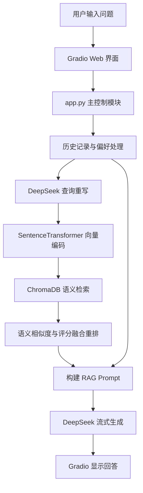

# 🎬 Movie RAG：基于大语言模型的电影检索与推荐系统

## 1. 项目简介

Movie RAG 是一个基于 Python 开发的电影检索与推荐问答系统。

项目结合 SentenceTransformer、ChromaDB 和 DeepSeek，
通过检索增强生成（RAG）技术，为用户提供自然语言电影推荐服务。

系统支持电影语义检索、基于评分的融合重排序、多轮对话、
查询重写以及大模型流式回答。

项目使用 Gradio 构建 Web 交互界面，
用户可以直接通过浏览器进行电影推荐问答。

### 核心技术栈

- Python 3.11
- Gradio：Web 交互界面
- ChromaDB：电影向量数据库
- SentenceTransformers：文本向量编码
- DeepSeek API：查询重写与回答生成
- Pandas：检索结果重排序

### 核心功能

1. **电影语义检索**：根据自然语言问题检索相关电影。
2. **融合重排序**：结合语义相似度和电影评分计算综合得分。
3. **多轮对话**：利用历史记录理解用户的连续追问。
4. **查询重写**：将依赖上下文的问题改写为完整检索语句。
5. **流式回答**：通过 DeepSeek 逐步生成电影推荐回答。
6. **用户偏好提取**：识别用户表达的电影类型偏好。

> 注：用户偏好的跨轮状态保存与严格去重效果仍需进一步验证。

## 2. 项目架构



### 模块职责

- `app.py`：负责用户输入、历史记录、状态管理及整个 RAG 流程。
- `retriever.py`：负责向量编码、ChromaDB 检索和融合排序。
- `llm_client.py`：负责调用 DeepSeek，完成查询重写、偏好提取和回答生成。


## 3. 项目目录结构

以下是项目最终交付时的目录规划：

```text
Movie-RAG/
├── app.py                 # Gradio Web 主程序
├── retriever.py           # 电影语义检索与融合排序
├── llm_client.py          # DeepSeek API 调用模块
├── environment.yml        # Conda 环境依赖
├── README.md              # 项目介绍与运行指南
├── technical_notes.md     # Bug 排查与技术总结（待添加）
└── .gitignore             # Git 文件忽略规则
```

### 电影数据库

本项目使用预构建的 ChromaDB 向量数据库，包含 9724 条电影记录。

数据库压缩包 `chroma_movie_db_v2.tar.gz` 将通过 GitHub Releases 提供。

下载后，需要将数据库解压到项目根目录，形成：

```text
Movie-RAG/
└── chroma_movie_db_v2/
```

该目录包含电影向量和元数据，程序启动后直接读取，
无需重新计算全部电影向量。

### 核心模块说明

- **app.py**：负责接收用户问题、维护会话历史、组织 RAG 流程及展示回答。
- **retriever.py**：负责文本向量化、ChromaDB 检索和评分融合重排序。
- **llm_client.py**：负责查询重写、用户偏好提取和流式生成回答。
- **environment.yml**：记录 Python 及相关依赖，方便环境复现。


## 4. 环境安装与运行

本项目推荐在 Linux 或 Windows WSL2（Ubuntu）环境下运行。

### 4.1 环境要求

- 操作系统：Linux / Windows WSL2（Ubuntu）
- Python：3.11
- 环境管理工具：Miniconda 或 Anaconda
- 网络：首次下载模型以及调用 DeepSeek API 时需要网络连接
- DeepSeek API Key：用户需要自行申请

### 4.2 安装 Python 依赖

首先，克隆项目仓库：

```bash
git clone https://github.com/xiazhi0625/Movie-RAG.git
cd Movie-RAG
```

注意：正式发布后，请将上面的占位地址替换为真实的 GitHub 仓库地址。

使用项目提供的 environment.yml 创建 Conda 环境：

```bash
conda env create -f environment.yml
```

激活环境：

```bash
conda activate movie_rag
```

检查 Python 版本：

```bash
python --version
```

预期 Python 版本为 3.11.x。

安装完成后，可以通过以下命令检查核心依赖：

```bash
python -c "import gradio, chromadb, sentence_transformers, openai, pandas; print('核心依赖导入成功')"
```

注意：environment.yml 基于 Ubuntu WSL2 环境导出，其他操作系统可能需要调整依赖。首次安装时间取决于网络和下载速度。


### 4.3 下载和配置电影数据库

本项目使用 ChromaDB 作为向量数据库，包含 9724 条电影记录。

为了减少首次运行时间，项目提供预构建的电影向量数据库，用户不需要重新生成所有电影向量。

**步骤一：下载数据库**

进入项目 GitHub 页面的 Releases 页面，下载：

`chroma_movie_db_v2.tar.gz`

数据库下载地址：https://github.com/xiazhi0625/Movie-RAG/releases/tag/v1.0.0

注意：上述地址将在正式发布 GitHub Release 后替换。

**步骤二：解压数据库**

将下载的压缩包放入项目根目录，然后执行：

```bash
tar -xzf chroma_movie_db_v2.tar.gz
```

解压后，项目目录中应该出现：

```text
Movie-RAG/
├── app.py
├── retriever.py
├── llm_client.py
└── chroma_movie_db_v2/
```

**步骤三：验证数据库**

在已经激活 movie_rag 环境的终端中执行：

```bash
python - <<'PY'
import chromadb

client = chromadb.PersistentClient(
    path="./chroma_movie_db_v2"
)

collection = client.get_collection(
    name="movie_collection_v2"
)

print("数据库记录数：", collection.count())
PY
```

预期输出：

```text
数据库记录数： 9724
```

如果正常输出 9724，说明数据库已成功加载。

注意：运行验证命令前，应确保终端位于项目根目录。


### 4.4 配置 DeepSeek API Key

本项目使用 DeepSeek API 完成查询重写、用户偏好提取和回答生成。

使用前，需要访问 DeepSeek 开放平台申请自己的 API Key：

https://platform.deepseek.com/

**步骤一：设置环境变量**

在 WSL2 Ubuntu 或 Linux 终端中执行：

```bash
read -r -s -p "请输入 DeepSeek API Key: " DEEPSEEK_API_KEY
echo
export DEEPSEEK_API_KEY
```

按提示输入 API Key，然后按 Enter。

输入过程中，终端不会显示密钥内容。这是正常现象。

**步骤二：验证配置**

执行：

```bash
python -c "import os; print('API Key 已配置' if os.getenv('DEEPSEEK_API_KEY') else 'API Key 未配置')"
```

如果显示：

```text
API Key 已配置
```

说明当前终端已经成功设置环境变量。

注意：

- 不要将 API Key 直接写入 Python 源代码。
- 不要将真实 API Key 上传到 GitHub。
- 该环境变量只在当前终端会话及其子进程中有效。
- 重新打开终端后，需要重新设置 API Key。
- 此检查只验证环境变量是否存在，不代表密钥一定有效。


### 4.5 下载和配置 Embedding 模型

本项目使用以下 SentenceTransformer 模型进行文本向量编码：

`sentence-transformers/paraphrase-multilingual-MiniLM-L12-v2`

该模型用于将用户问题转换成向量，并与 ChromaDB 中的电影向量进行检索匹配。

**步骤一：首次下载模型**

确保已经激活 `movie_rag` 环境，并能够访问 Hugging Face。

在终端执行：

```bash
HF_HUB_OFFLINE=0 TRANSFORMERS_OFFLINE=0 python -c "from sentence_transformers import SentenceTransformer; SentenceTransformer('sentence-transformers/paraphrase-multilingual-MiniLM-L12-v2'); print('模型下载或加载成功')"
```

首次运行时，程序会检查本地缓存；如果模型尚未下载，则尝试从 Hugging Face 下载。

模型地址：

https://huggingface.co/sentence-transformers/paraphrase-multilingual-MiniLM-L12-v2

**步骤二：验证本地模型**

下载完成后，可以执行：

```bash
HF_HUB_OFFLINE=1 TRANSFORMERS_OFFLINE=1 python -c "from sentence_transformers import SentenceTransformer; model = SentenceTransformer('paraphrase-multilingual-MiniLM-L12-v2', local_files_only=True); print('本地模型加载成功')"
```

如果出现：

```text
本地模型加载成功
```

说明模型已经可以从本地加载。

**步骤三：启用离线模式**

正式启动项目时，建议使用：

```bash
HF_HUB_OFFLINE=1 TRANSFORMERS_OFFLINE=1 python -u app.py
```

这样可以避免 Hugging Face 在启动时反复进行网络检查。

注意：

- 离线模式不会自动下载缺失的模型文件。
- 如果首次下载失败，需要先解决 Hugging Face 网络访问问题。
- 模型文件不是 ChromaDB 数据库，两者都需要准备。
- 首次下载所需时间取决于网络环境，不保证在 10 分钟内完成。


### 4.6 启动电影推荐系统

完成前面的环境配置后，即可启动 Gradio Web 应用。

**步骤一：进入项目目录**

```bash
cd Movie-RAG
```

如果已经处于项目根目录，可跳过此步骤。

**步骤二：激活 Conda 环境**

```bash
conda activate movie_rag
```

**步骤三：确认 API Key 已配置**

```bash
python -c "import os; print('API Key 已配置' if os.getenv('DEEPSEEK_API_KEY') else '请先配置 API Key')"
```

如果尚未配置，请返回第 4.4 节进行设置。

**步骤四：启动程序**

```bash
HF_HUB_OFFLINE=1 TRANSFORMERS_OFFLINE=1 python -u app.py
```

成功启动后，终端通常会显示：

```text
Running on local URL: http://0.0.0.0:7860
```

**步骤五：打开 Web 页面**

在 Windows 或 Linux 本机浏览器中访问：

http://localhost:7860

正常情况下，可以看到 AI 电影推荐助手的聊天界面。

### 4.7 功能测试

建议使用以下问题测试系统：

1. 推荐一部科幻电影。
2. 还有其他的吗？
3. 再推荐一部，不要和之前重复。
4. 我喜欢爱情电影。

其中，第二、三条可以用于观察系统是否能够理解多轮对话。

用户偏好跨轮保存、严格去重及事实准确性需要单独验证，不能仅凭界面正常返回就认定全部通过。

### 4.8 常见启动问题

**问题一：Hugging Face 网络连接失败**

确保已提前下载 Embedding 模型，并按照第 4.5 节使用离线模式启动。

**问题二：7860 端口被占用**

可以执行：

```bash
ss -ltnp | grep ':7860'
```

确认占用端口的进程后，关闭旧服务，再重新启动。

**问题三：找不到 DeepSeek API Key**

确认当前终端已设置 `DEEPSEEK_API_KEY` 环境变量。

**问题四：ChromaDB 集合不存在**

确认 `chroma_movie_db_v2` 文件夹位于项目根目录，并且集合名称为 `movie_collection_v2`。

**关闭程序**

在运行 Gradio 的终端按 Ctrl+C，即可停止服务。

## 5. 数据来源与使用许可

本项目使用 GroupLens Research 发布的 MovieLens latest-small 数据集。

- 原始数据集：MovieLens ml-latest-small
- 原始数据包含 9742 部电影
- 本项目处理后的 ChromaDB 集合包含 9724 条记录
- 数据用于学习、实验和非商业演示

数据集及其转换版本的再分发须遵守原数据集相同的许可条件，包括注明来源、不得暗示 GroupLens 对本项目的认可，以及未经许可不得用于商业用途。

官方数据集与许可说明：
https://files.grouplens.org/datasets/movielens/ml-latest-small-README.html

参考文献：
Harper, F. M., & Konstan, J. A. (2015).
The MovieLens Datasets: History and Context.
ACM Transactions on Interactive Intelligent Systems, 5(4).
https://doi.org/10.1145/2827872
